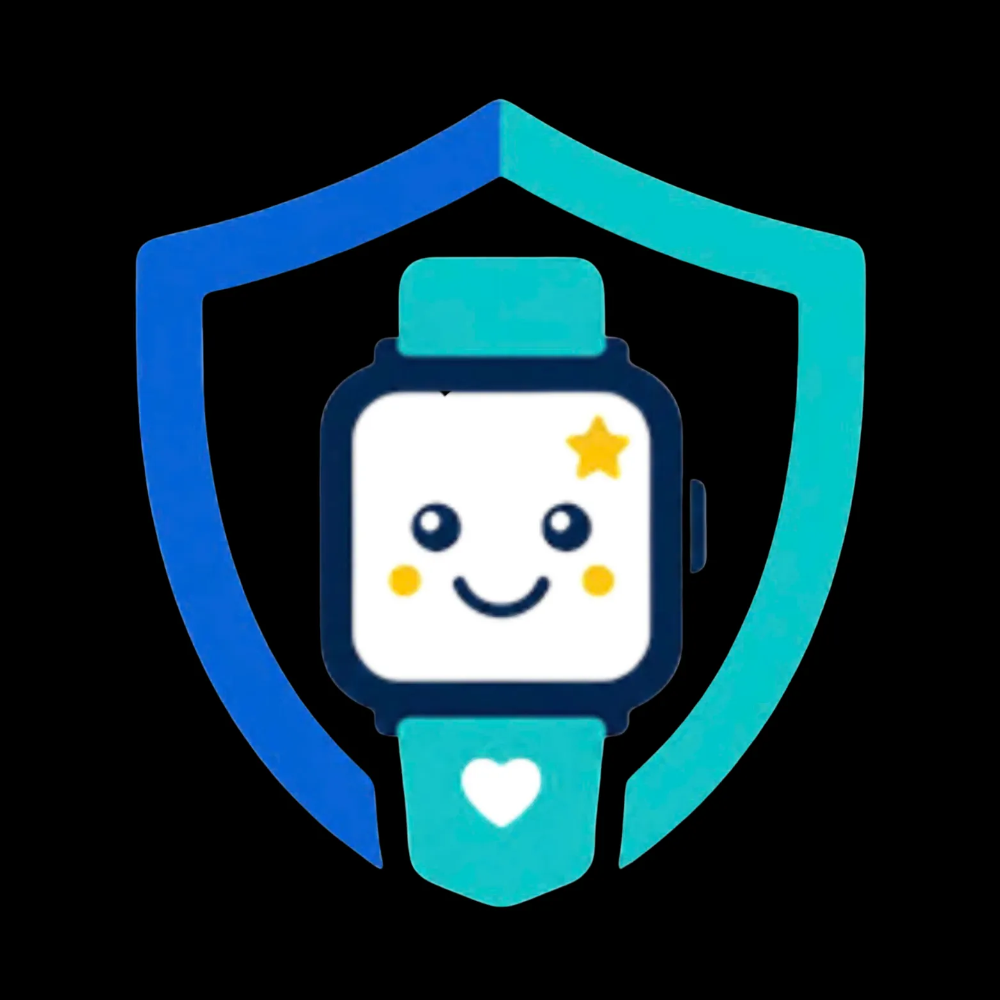
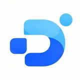
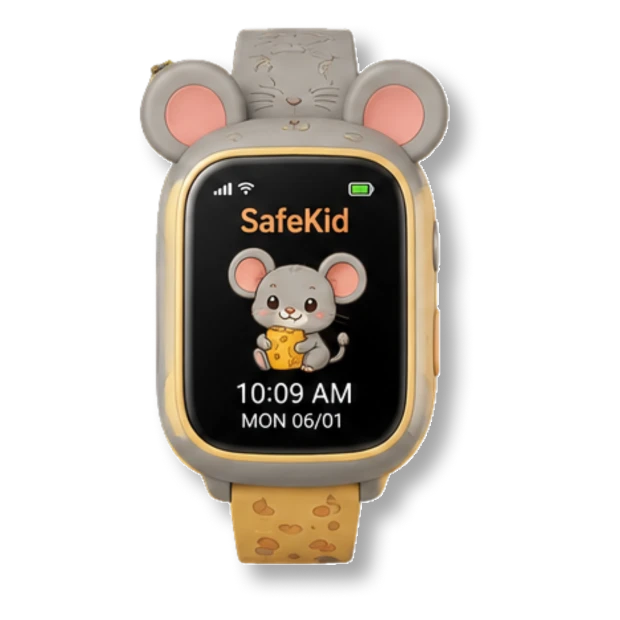
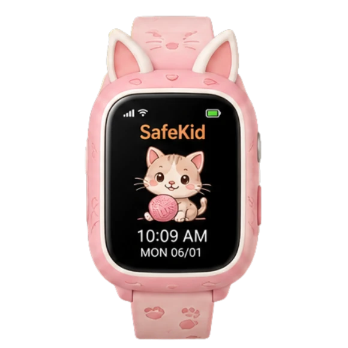
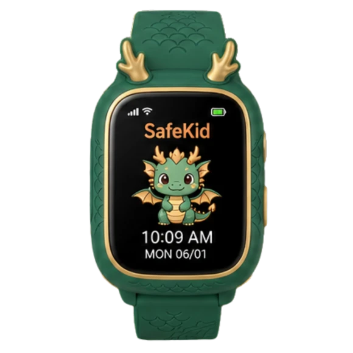
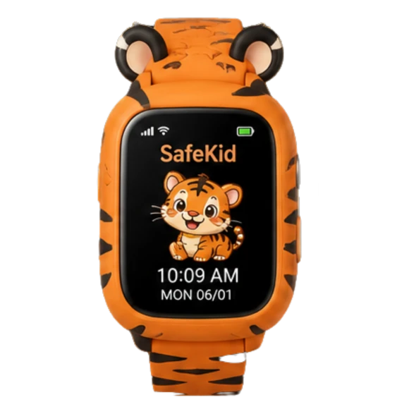

  
  

<h1 align="center">SafeKid x DigiBabi</h1>

<h3 align="center">The Space Between Them</h3>

  A child-focused smartwatch concept by DigiBabi.
   
  More room to grow. More ways to stay connected.

  
  
  
  
  

  <a href="https://digibabi.id.vn">Website</a>
  ·
  <a href="https://github.com/FynisFL/SafeKid_Web_Demo_Prototype">Repository</a>
  ·
  <a href="./CodeGuideline.md">Code Guidelines</a>

# SafeKid - The Space Between Them

**SafeKid** là dự án sản phẩm công nghệ do đội ngũ **DigiBabi** phát triển, với ý tưởng kết hợp đồng hồ thông minh dành cho trẻ em và trải nghiệm kết nối dành cho phụ huynh.

Dự án hướng đến việc tạo thêm không gian để trẻ tự do khám phá, đồng thời giúp phụ huynh an tâm hơn trong quá trình trưởng thành của con.

🌐 [**Website**](https://digibabi.id.vn)

💻 [**Repository**](https://github.com/FynisFL/SafeKid_Web_Demo_Prototype)

**<a href="https://www.facebook.com/DigiBabi">
  
   Facebook
</a>**

---

## 1. Giới thiệu sản phẩm

SafeKid được xây dựng xoay quanh 6 nhóm tính năng thiết kế:

- Real-Time GPS Tracking — Định vị thời gian thực.
- Two-Way Calling — Liên lạc hai chiều.
- One-Touch SOS — Tương tác yêu cầu trợ giúp.
- Safe Zone Alerts — Cảnh báo vùng an toàn.
- Habit & Reward — Hình thành thói quen và khen thưởng.
- Battery — Định hướng tối ưu thời lượng sử dụng.

<h2 align="center">Explore the SafeKid Collection</h2>

  
  
  
  

### Trải nghiệm trên website

- **Zodiac Collection:** Bộ sưu tập 12 phiên bản đồng hồ lấy cảm hứng từ 12 con giáp Việt Nam.
- **Watch Passport:** Trải nghiệm tương tác giới thiệu sản phẩm.
- **SOS Demo:** Mô phỏng thao tác nhấn giữ nút SOS.
- **S.F AI:** Giao diện trợ lý hỗ trợ tìm hiểu thông tin về SafeKid.
- **A Little Detour:** Mini game Easter Egg ẩn trên website.

> **Lưu ý:** SafeKid hiện là dự án concept và prototype. Các tính năng định vị, gọi điện, cảnh báo và kết nối thiết bị chưa hoạt động như dịch vụ thực tế. SOS chỉ là mô phỏng cục bộ, không gửi cảnh báo hay liên hệ dịch vụ khẩn cấp.

## 2. Công nghệ sử dụng

| Nhóm | Công nghệ |
|---|---|
| Frontend | React 19, TypeScript |
| Build Tool | Vite 7 |
| Routing | React Router 7 |
| Styling | Tailwind CSS |
| Animation | Motion |
| UI Components | Radix UI |
| Icons | Lucide React |
| Form & Validation | React Hook Form, Zod |
| Deployment | GitHub Pages, GitHub Actions |

Một số thư viện hỗ trợ khác gồm TanStack React Query, Recharts, Embla Carousel, Supabase JS SDK và Sonner.

## 3. AI hỗ trợ phát triển

Các công cụ và trợ lý AI được sử dụng trong quá trình nghiên cứu, thiết kế và phát triển SafeKid:

| Công cụ / AI | Vai trò |
|---|---|
| OpenAI ChatGPT | Phân tích, lập kế hoạch, hỗ trợ code và xử lý lỗi |
| Anthropic Claude | Phân tích source, đề xuất kiến trúc và cải thiện giao diện |
| GitHub Copilot | Hỗ trợ lập trình trong IDE |
| LongCat | Hỗ trợ coding và nghiên cứu kỹ thuật |

**Công cụ phát triển đi kèm:** Figma, Figma MCP, Kombai, Hermes Desktop và GitHub.

*Lưu ý: Các AI trên hỗ trợ quá trình phát triển, không phải những mô hình đang chạy trực tiếp trong website. S.F AI hiện sử dụng logic kịch bản và nhận diện từ khóa cục bộ, chưa kết nối API LLM bên ngoài.*

## 4. Đội ngũ phát triển — DigiBabi

| Thành viên | Vai trò | Phụ trách |
|---|---|---|
| **Nguyễn Trường Duy** | Leader · Co-founder · Main Developer | Phát triển, thiết kế sản phẩm, UX/UI, kiến trúc và tìm kiếm nguồn cung OEM |
| **Huỳnh Kiều Ngọc Linh** | Deputy Leader · Co-founder | Kiểm thử, nghiên cứu đối thủ, marketing, kế hoạch và tính toán chi phí |
| **Tô Đỗ Trọng Nhân** | Co-founder | Storytelling, nghiên cứu và phân tích đối thủ |
| **Nguyễn Thị Phương Uyên** | Co-founder | Nghiên cứu đối thủ, storytelling và đóng góp ý tưởng |

## 5. Định hướng dự án

SafeKid không chỉ hướng đến một thiết bị công nghệ, mà còn khám phá cách công nghệ có thể hỗ trợ sự độc lập của trẻ em và duy trì kết nối trong gia đình.

**More room to grow. More ways to stay connected.**

---

**Developed by DigiBabi**  
*A student startup project exploring design, technology, and family connection.*

---

📘 **Tài liệu kỹ thuật:** Xem [CodeGuideline.md](./CodeGuideline.md) để tìm hiểu cấu trúc source code, quy chuẩn lập trình và hướng dẫn phát triển dự án.
**About Fynis/FynisFL:** [LinkBout/Fynis](https://www.linkbout.com/fynis) - thông tin liên hệ
